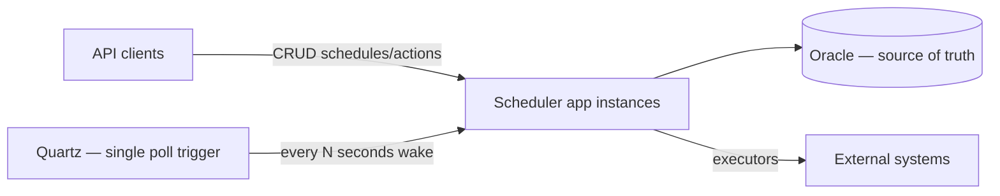
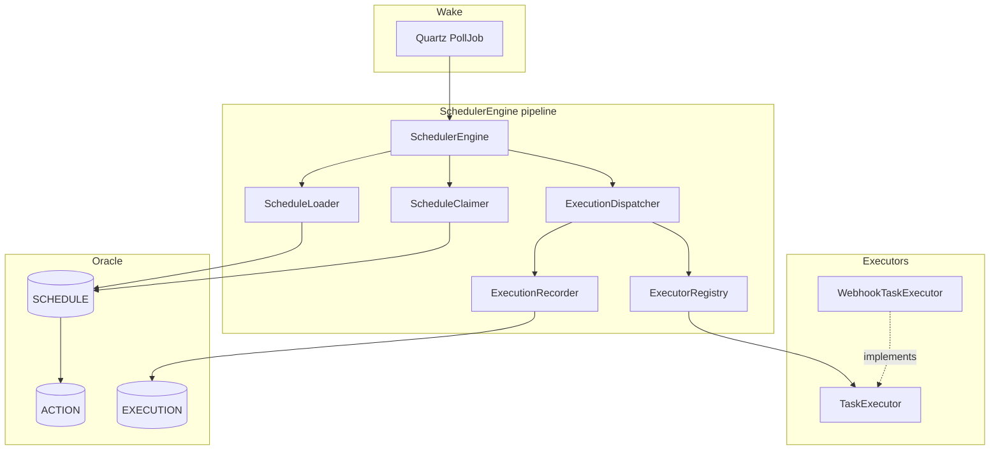
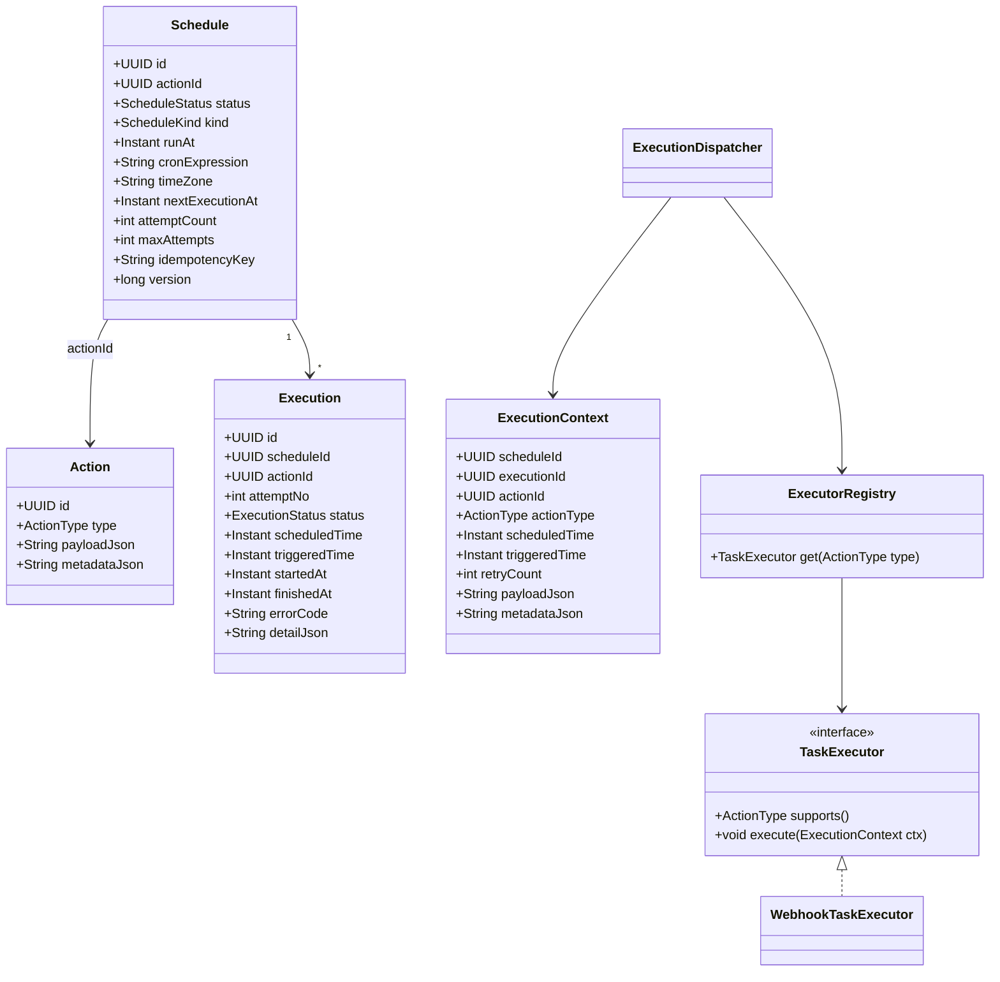
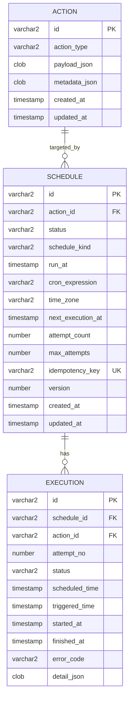
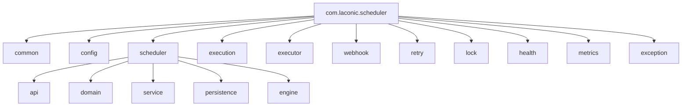
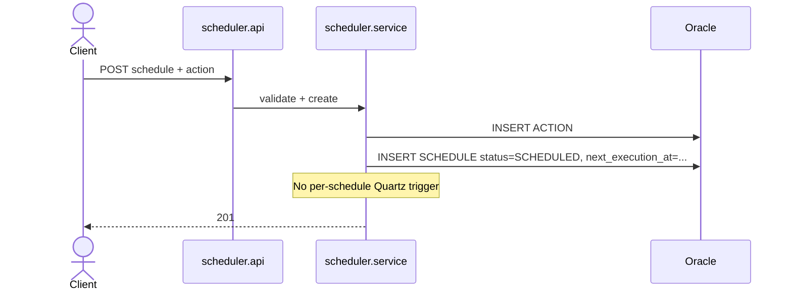
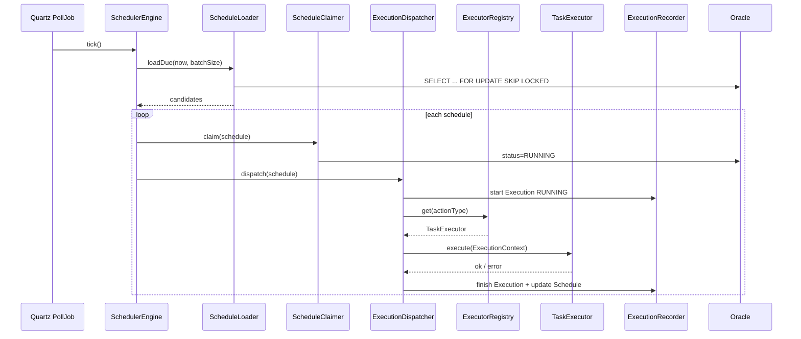
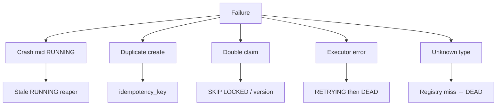

# Laconic Scheduler — Architecture

Project: **scheduler**  
Stack: Java 21 · Spring Boot 4 · Spring Data JPA · Spring MVC · Quartz · Oracle · WebClient · Maven

**Document version:** 2.0 (revised after architecture review)  
**Status:** Architecture improved → Feature 1 in progress

Implementation proceeds **feature by feature**. Do not implement the whole platform in one pass.

---

## 0. Architecture review (v1 → v2)

This section challenges the previous design. Good ideas are kept; flawed ones are replaced.

### 0.1 What was good (preserved)

| Decision | Why keep it |
|----------|-------------|
| Database as source of truth | Restart-safe; multi-instance safe |
| Stateless app instances | Horizontal scale |
| `TaskExecutor` abstraction | Open/Closed for execution types |
| Execution history table | Audit, retry, metrics |
| Idempotency on create | Safe client retries |
| Constructor injection / SOLID / Clean Architecture | Maintainability |

### 0.2 Weaknesses in v1

#### W1 — One Quartz trigger per schedule

**Problem:** Creating a Quartz `JobDetail`/`Trigger` for every schedule couples business data to Quartz, causes table bloat at scale, and makes Quartz a second source of timing truth.

**Why it hurts:** Millions of schedules ⇒ millions of Quartz rows; reconcile logic becomes mandatory; cancel/reschedule always touches Quartz; cluster misfires are harder to reason about.

**Improvement:** Quartz runs **one** lightweight polling job (e.g. every 5 seconds). Scheduling logic lives in `SchedulerEngine` over Oracle (`next_execution_at`).

#### W2 — Single `ScheduledTask` entity mixed WHEN + WHAT

**Problem:** One aggregate held schedule timing, action payload, and status. That mixes two bounded concepts and encourages `if (type == WEBHOOK)` in core.

**Improvement:** Separate **Schedule** (WHEN) from **Action** (WHAT). Schedule references Action; executors only see action type + payload via `ExecutionContext`.

#### W3 — Ambiguous status model (`ACTIVE` / `COMPLETED`)

**Problem:** `ACTIVE` does not say whether a fire is in progress. `FAILED` vs retry was unclear.

**Improvement:** Explicit lifecycle: `CREATED` → `SCHEDULED` → `RUNNING` → `SUCCESS` | `FAILED` → `RETRYING` → `DEAD` (plus `CANCELLED` / `PAUSED`).

#### W4 — Layer packages hid features

**Problem:** `infrastructure.webhook` vs `domain` scatter related code; navigation suffers as types grow.

**Improvement:** Feature-oriented packages: `scheduler`, `execution`, `executor`, `webhook`, `retry`, `lock`, …

#### W5 — Quartz as cluster coordinator for business fires

**Problem:** Relying on Quartz JDBC clustering for *which schedule runs* blurs ownership.

**Improvement:** Quartz only wakes the poller. **Duplicate prevention** is Oracle row claiming (`FOR UPDATE SKIP LOCKED` and/or optimistic `version`).

#### W6 — No first-class engine pipeline

**Problem:** Fire path was “Quartz Job → service → executor” with unclear SRP boundaries.

**Improvement:** Explicit pipeline:

```text
SchedulerEngine → ScheduleLoader → ScheduleClaimer
  → ExecutionDispatcher → TaskExecutor → ExecutionRecorder
```

#### W7 — Executor selection risked type switches

**Problem:** Document mentioned resolving by type but did not mandate a registry.

**Improvement:** `ExecutorRegistry` maps `ActionType` → `TaskExecutor`. Core never uses `if (type == …)`.

#### W8 — Primitive-heavy execute signature

**Problem:** Passing ids and timestamps as loose arguments does not scale.

**Improvement:** Immutable `ExecutionContext` record passed to every executor.

---

## 1. Role and goal

Build a **stateless, horizontally scalable** scheduling platform:

| Concern | Owner |
|---------|--------|
| **When** to run | Schedule + `SchedulerEngine` (Oracle) |
| **What** to run | Action |
| **How** to run | `TaskExecutor` implementations |
| **Wake timer** | Quartz (single poll job only) |

### First action type

| ActionType | Executor |
|------------|----------|
| `WEBHOOK` | `WebhookTaskExecutor` |

### Future action types (zero core changes)

Email · SMS · Kafka · RabbitMQ · AWS SQS · Custom Java Handler

Adding a type = new `TaskExecutor` bean (+ optional package). No edits to `SchedulerEngine`.

---

## 2. Architecture principles

| Principle | Meaning |
|-----------|---------|
| **Database first** | Oracle owns schedules, actions, executions, retries |
| **Stateless** | No schedule state in JVM memory |
| **Quartz is a timer only** | Not the schedule catalog |
| **Schedule ≠ Action** | WHEN vs WHAT |
| **Engine pipeline** | Small, single-purpose components |
| **Registry, not switches** | `ExecutorRegistry` |
| **Claim in DB** | Multi-instance safe |

### Philosophy

```text
Quartz (tick)
    → SchedulerEngine
        → load due Schedules from DB
        → claim Schedule
        → dispatch via ExecutorRegistry
        → TaskExecutor.execute(ExecutionContext)
        → record Execution + update next_execution_at / status
```

---

## 3. System context



---

## 4. Component relationships



### Pipeline responsibilities

| Component | Single responsibility |
|-----------|----------------------|
| `SchedulerEngine` | Orchestrate one poll cycle |
| `ScheduleLoader` | Query due `SCHEDULED` / `RETRYING` rows (`next_execution_at <= now`) |
| `ScheduleClaimer` | Atomically claim a row for this instance |
| `ExecutionDispatcher` | Build `ExecutionContext`, resolve executor, invoke |
| `ExecutorRegistry` | Map `ActionType` → `TaskExecutor` |
| `TaskExecutor` | Perform the side effect |
| `ExecutionRecorder` | Persist attempt + advance schedule state / next time |

---

## 5. Domain model — Schedule vs Action



### 5.1 Schedule status lifecycle

```text
CREATED
  → SCHEDULED
      → RUNNING
          → SUCCESS          (terminal for ONCE; CRON returns to SCHEDULED)
          → FAILED
              → RETRYING     (next_execution_at set)
                  → RUNNING
              → DEAD         (retries exhausted — dead letter)
      → CANCELLED
      → PAUSED
```

| Status | Meaning |
|--------|---------|
| `CREATED` | Persisted; not yet eligible for poll |
| `SCHEDULED` | Eligible when `next_execution_at <= now` |
| `RUNNING` | Claimed by an instance; execution in progress |
| `SUCCESS` | Last run succeeded (ONCE terminal; CRON may move back to `SCHEDULED`) |
| `FAILED` | Last run failed; may transition to `RETRYING` or `DEAD` |
| `RETRYING` | Waiting for retry time (`next_execution_at`) |
| `DEAD` | Terminal failure / DLQ |
| `CANCELLED` | User cancelled |
| `PAUSED` | Temporarily excluded from loader |

### 5.2 Other enums

| Enum | Values |
|------|--------|
| `ScheduleKind` | `ONCE_AT`, `CRON` |
| `ActionType` | `WEBHOOK` (+ future) |
| `ExecutionStatus` | `RUNNING`, `SUCCESS`, `FAILED`, `SKIPPED` |

### 5.3 ExecutionContext (required)

Executors receive **only** `ExecutionContext` (Java record), never a bag of primitives:

- `scheduleId`, `executionId`, `actionId`
- `actionType`
- `scheduledTime`, `triggeredTime`
- `retryCount`
- `payloadJson`, `metadataJson`

---

## 6. Database schema (business — not Quartz)

Quartz may use in-memory or minimal JDBC for the **single** poll trigger. Business tables do **not** depend on `QRTZ_*`.



### Indexes (scale)

- `SCHEDULE (status, next_execution_at)` — due poll query  
- `SCHEDULE (idempotency_key)` — unique  
- `EXECUTION (schedule_id, attempt_no)` — unique  

### Claiming (horizontal scale)

Preferred claim pattern:

```sql
SELECT ... FROM schedule
 WHERE status IN ('SCHEDULED', 'RETRYING')
   AND next_execution_at <= :now
 ORDER BY next_execution_at
 FETCH FIRST :batch ROWS ONLY
 FOR UPDATE SKIP LOCKED
```

Then set `status = RUNNING`, bump `version`, commit. Other instances skip locked rows.

---

## 7. Package structure (feature-oriented)

```text
com.laconic.scheduler
├── SchedulerApplication
├── common
├── config
├── scheduler
│   ├── api
│   ├── domain          # Schedule, Action, enums, policies
│   ├── service         # application services (CRUD)
│   ├── persistence     # JPA entities/repos if split from domain
│   └── engine          # SchedulerEngine, Loader, Claimer
├── execution
│   ├── dispatcher
│   ├── context         # ExecutionContext
│   ├── domain          # Execution entity + status
│   ├── persistence
│   └── recorder
├── executor
│   ├── TaskExecutor
│   └── ExecutorRegistry
├── webhook             # WebhookTaskExecutor (+ DTOs if needed)
├── retry
├── lock
├── health
├── metrics
└── exception
```



**Dependency rule:** `engine` / `dispatcher` depend on `executor` abstractions; `webhook` depends on `executor` + `execution.context`; scheduler core never depends on `webhook`.

---

## 8. Request lifecycle

### 8.1 Create schedule + action



### 8.2 Poll → execute



### 8.3 Cancel

1. Set schedule `CANCELLED` in DB.  
2. Loader ignores it.  
3. No Quartz unschedule of per-task triggers (none exist).  
4. In-flight `RUNNING` may finish; recorder must not revive cancelled schedules.

---

## 9. Failure scenarios

| Failure | Mitigation |
|---------|------------|
| Instance crash while `RUNNING` | Reaper job: stale `RUNNING` past lease → `RETRYING` or `FAILED` |
| Two instances poll same due row | `FOR UPDATE SKIP LOCKED` / version claim |
| Duplicate create | Unique `idempotency_key` |
| Executor failure | Recorder + retry policy → `RETRYING` or `DEAD` |
| Poison payload | Validate on create; on execute → `DEAD` without infinite retry |
| Oracle down | Fail API / skip tick; no in-memory fallback truth |
| Unknown `ActionType` | Registry throws; mark execution `FAILED` / schedule `DEAD` |



---

## 10. Quartz’s role (explicit)

| Quartz does | Quartz does **not** |
|-------------|---------------------|
| Fire one poll job every N seconds | Store one trigger per business schedule |
| Optionally cluster so only one poll fires at a time (nice-to-have) | Own next-run business logic |
| | Store action payloads |

At high scale, poll batch size and indexes matter more than Quartz job count (always O(1) jobs).

---

## 11. Future scalability

| Concern | Approach |
|---------|----------|
| Millions of schedules | Indexed due query + batch claim; partition later if needed |
| Horizontal nodes | Stateless + SKIP LOCKED |
| Retry / DLQ | `RETRYING` / `DEAD` + execution history |
| New executors | New bean implementing `TaskExecutor` |
| Metrics / health | Micrometer per executor; poll lag gauge |
| Redis | Optional rate-limit / secondary lock — not required for truth |

---

## 12. Coding standards

- Java 21, Spring Boot 4, constructor injection only  
- SOLID, small classes/methods, no duplicated logic  
- Immutable DTOs / records (`ExecutionContext`)  
- Clear transaction boundaries (claim vs execute vs record)  
- JavaDoc on public APIs  
- Unit tests for domain transitions and registry  

---

## 13. Local run

```bat
cd D:\Laconic\dev\neutral-tex\scheduler
copy .env.example .env
run.bat
```

- Port **8010** by default (`SCHEDULER_PORT`)  
- Health: `http://localhost:8010/actuator/health`

---

## 14. Implementation order

| # | Feature | Status |
|---|---------|--------|
| 0 | Skeleton + `run.bat` | Done |
| 1 | Domain model + Oracle schema | Done |
| 2 | Persistence repositories + claim query | Done |
| 3 | SchedulerEngine pipeline (load/claim/dispatch/record) | **Done** |
| 4 | Quartz single PollJob | **Done** |
| 5 | `TaskExecutor` + `ExecutorRegistry` | Done (minimal; webhook stub) |
| 6 | `WebhookTaskExecutor` (real HTTP) | **Done** |
| 7 | API (create/get/cancel) | Next |
| 8 | Retry + stale RUNNING reaper | Pending |
| 9 | Health / metrics | Pending |

---

## 15. Feature 1 scope

**In scope**

- Domain enums and entities: `Schedule`, `Action`, `Execution`
- Oracle DDL (Flyway)
- JPA mapping aligned to schema
- Unit tests for schedule lifecycle transitions

**Out of scope**

- Engine, Quartz poll, executors, HTTP API, WebClient

---

## 16. Feature 2 scope

**Design**

- Spring Data repositories for CRUD / idempotency / unlocked due peek
- `ScheduleLoader` locks due rows with Oracle `FOR UPDATE SKIP LOCKED`
- `ScheduleClaimer` applies domain `markRunning()` and saves
- Same transaction must wrap load + claim (enforced by Feature 3 engine)

**Why**

- Horizontal scale without per-schedule Quartz triggers
- Peer instances skip locked rows instead of waiting / double-firing
- Domain rules stay outside SQL (`markRunning`)

**In scope**

- `ActionRepository`, `ScheduleRepository`, `ExecutionRepository`
- `OracleScheduleLoader`, `DomainScheduleClaimer`
- Unit tests with mocked `EntityManager` / repository

**Out of scope**

- Full `SchedulerEngine` tick loop, Quartz poll job, executors, HTTP API

---

## 17. Feature 3 scope + ops notes

**Flyway removed.** Schema is created/updated by Hibernate (`spring.jpa.hibernate.ddl-auto=update`) against Oracle `LCN_SCHEDULER`. Reference DDL: `src/main/resources/db/schema-oracle.sql`.

**Pipeline**

```text
SchedulerEngine.tick
  → ScheduleLoader (SKIP LOCKED)
  → ScheduleClaimer (RUNNING)
  → ExecutionDispatcher
       → ExecutionRecorder
       → ExecutorRegistry → TaskExecutor (Webhook stub)
  → schedule SUCCESS / RETRYING / DEAD
```

**Oracle**

```env
SPRING_DATASOURCE_URL=jdbc:oracle:thin:@//192.168.0.131:1521/LACONIC
SPRING_DATASOURCE_USERNAME=LCN_SCHEDULER
SPRING_DATASOURCE_PASSWORD=***
```

**In scope**

- `DefaultSchedulerEngine`, `DefaultExecutionDispatcher`, `JpaExecutionRecorder`
- `ExecutorRegistry`, `TaskExecutor`, stub `WebhookTaskExecutor`
- Unit + Oracle IT (`SchedulerEngineOracleIT`)

**Out of scope**

- Quartz poll job, real HTTP webhook, REST API

---

## 18. Feature 4 scope

**Design**

- Exactly **one** Quartz `JobDetail` + repeating trigger (`scheduler.poll.interval-ms`, default 5000)
- `SchedulePollJob` → `SchedulerEngine.tick()` only
- In-memory Quartz job store (business data stays in Oracle)
- `@DisallowConcurrentExecution` on the poll job
- `scheduler.poll.enabled=false` in tests so ITs call the engine directly

**Why**

- O(1) Quartz jobs regardless of schedule volume
- Oracle remains source of truth for due work

**In scope**

- `QuartzPollConfiguration`, `SchedulePollJob`, Spring job autowiring
- Unit tests for job + trigger config

**Out of scope**

- Real HTTP webhook, REST API, JDBC Quartz clustering

---

## 19. Feature 6 scope

**Design**

- `WebhookPayload` JSON: `url`, optional `method` (default POST), `headers`, `body`
- `WebhookPayloadParser` validates payload
- Shared `WebClient` with connect/response timeouts
- `WebhookTaskExecutor` performs HTTP call; 2xx = success; otherwise `TaskExecutionException` (`HTTP_xxx` / `HTTP_REQUEST_FAILED`)
- Adds scheduler tracing headers: `X-Scheduler-Schedule-Id`, `X-Scheduler-Execution-Id`, `X-Scheduler-Action-Id`, `X-Scheduler-Retry-Count`

**In scope**

- Real HTTP executor + parser + WebClient config
- Unit tests (MockWebServer) + Oracle IT with MockWebServer

**Out of scope**

- REST API to create schedules, retry reaper, metrics

---

*End of architecture v2.4*
